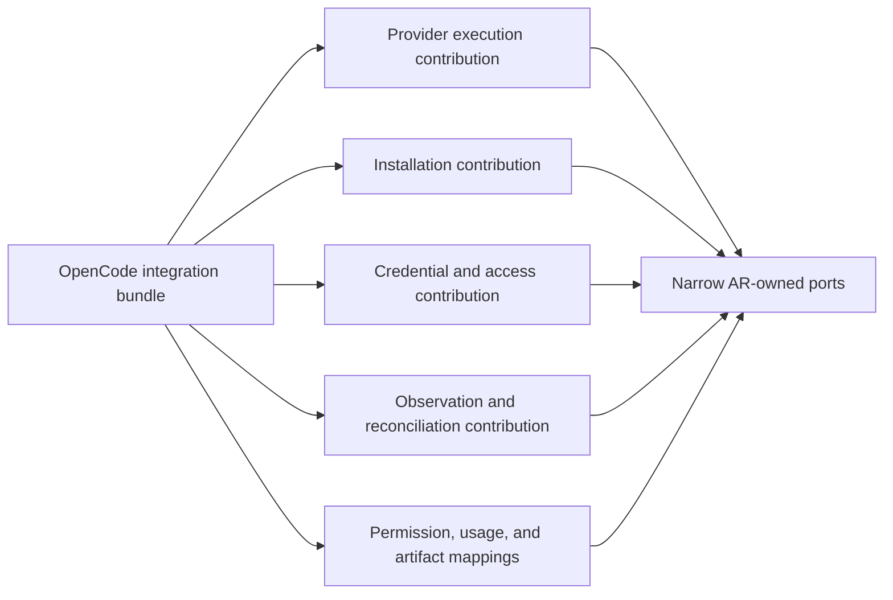

# Extension Model

## Terms

- **Extension** is a logical independently distributable implementation with an
  `ExtensionIdentity` used for artifact, admission, installation, and
  retirement lineage. It is not a Get Modular `CapabilityId` or
  `ImplementationId`.
- **Plugin artifact** is an installable, signed, immutable OCI artifact.
- **Contribution** is one implementation of one narrow consumer-owned extension
  point.
- **Integration bundle** is one plugin artifact that carries several related
  contributions released and qualified together.
- **Extension host** is the product-owned runtime that validates, activates,
  invokes, drains, and isolates extensions for that product.
- **Catalog** supplies discovery and governance metadata from one authoritative
  PostgreSQL-backed source. It does not store the artifact or grant product
  authority.
- **Catalog snapshot** is a signed immutable publication or export of catalog
  state. It is not a writable source or product authorization.

Identity namespaces remain distinct. A product-owned adapter may map an
admitted `ExtensionIdentity` plus contribution identity to a Get Modular
`ImplementationId` and a product-owned capability port. Equality or shared
string values never create that mapping, and neither repository allocates the
other's identities.

## Simple Plugin and Integration Bundle

A simple Frontend plugin may contribute one artifact preview. An Agent Runtime
provider integration usually needs several cooperating contributions:

The bundle is one unit of publication, signature, compatibility, installation,
and rollback. It is not one large interface, one class, one transaction, or one
authority owner. Every contribution still implements a narrow product-owned
contract and can be admitted or denied by capability.

## Adapter Is Not Automatically a Plugin

Adapter describes an architectural role. Plugin describes independent
distribution and lifecycle. A plugin may contain adapters, while many internal
adapters remain built into the product.

Good extension candidates include provider integrations, task-board connectors,
workflow engines, review strategies, activity renderers, and artifact previews.
Database repositories, aggregate invariants, authorization, fencing, and
canonical-state mutation are not ordinary plugins.

Sandbox and containment implementations are privileged system extensions, if
they become extensions at all. Agent Runtime owns their policy, enforcement
contract, qualification, and evidence. An ordinary third-party plugin cannot
select its own sandbox, grant itself capabilities, or weaken Runtime Security.

## Extension-Ready, Not Plugin-First

Built-in implementations should use the same semantic contract as external
implementations when a capability is intentionally replaceable. Built-ins may
use trusted in-process composition while untrusted extensions use stronger
isolation. Internal helpers are not exposed merely to maximize plugin count.

A public SPI requires two independent implementations, stable ownership,
compatibility fixtures, and a conformance suite. Until then, the boundary stays
internal even when its design is extension-ready.

## Comparative Plugin Ideas: Nakama (Non-Normative)

<!-- cspell:words Nakama -->

This is a source-backed **idea list, not an architecture decision or implementation
commitment**. Nakama's plugin features are useful established patterns, not
unique technical breakthroughs. Evaluate them critically against a concrete
Agent Teams product use case; do not copy its runtime or trust model.

Reference snapshot: [Nakama plugin authoring](https://github.com/ahmadrosid/nakama/blob/ad8769484bdf705ae926dedaec86e233abac6fcf/docs/plugins.md)
and [threat model](https://github.com/ahmadrosid/nakama/blob/ad8769484bdf705ae926dedaec86e233abac6fcf/THREAT_MODEL.md)
(revision `ad876948`, reviewed 2026-11-02).

| Observed pattern | Idea worth evaluating | Why it must not be copied blindly |
| --- | --- | --- |
| One package contributes agent actions, skills, a UI page, background workers, and private migrations | Offer a cohesive authoring and installation experience for related narrow contributions; retain the existing integration-bundle concept | Each contribution still needs a consumer-owned port, distinct permissions, lifecycle and evidence. Do not create a universal `PluginContext` or make every feature a plugin |
| An agent prepares a local plugin draft, while an administrator previews source and executable artifacts before installation | A reviewable draft-to-install flow with content digest, file/diff inspection, and initial disabled state could improve author experience | Preview must not run candidate code; verified bytes must match installed bytes. Human review is not sandboxing or runtime authorization |
| Package approval, organization enablement, and agent-profile tool assignment are separate actions | Make installation, per-organization activation, individual capability grants, and agent visibility intelligible to users | A signature, catalog label, prior approval or requested permission cannot become a grant. Revalidate current authority at invocation |
| Content-based immutable releases and organization-specific selection preserve state during upgrades | Explore deliberate update, rollback, migration preview, and retained private state with visible failure/recovery outcomes | Migrations must respect custody and schema authorities, fenced generations and uncertain effects. No plugin writes another product context's canonical tables |
| UI contribution slots and supervised plugin workers have explicit setup and cleanup | Explore host-owned UI placement, bounded worker lifetime, diagnostics and cleanup as separate product-local extension surfaces | Nakama documents trusted in-process Bun/browser execution without sandboxing. Do not inherit host privileges, expose raw secrets, or treat a worker/process as proof of isolation |
| Curated official-plugin catalog reduces installation friction | Consider a low-friction reviewed first-party path, including local/offline discovery when useful | A convenient catalog is not product authority; an `official` badge alone cannot bypass digest, compatibility, revocation or capability checks |

**Before adopting an idea:** identify its first real consumer and threat model;
compare a built-in adapter with a plugin; prove source-to-installed-byte integrity,
permission denial, failed setup/migration, restart/rollback and data retention;
and use two independent implementations plus conformance before publishing a
public SPI. Test user experience without creating another general-purpose host,
manager, graph or broker. A static Get Modular composition with controlled
restart remains distinct from dynamic plugin activation.

This note changes **no accepted ADR**, extension lifecycle, product-specific
SPI, installation policy, package admission or public API. For decisions and
qualification requirements, follow [ADR-0011](../decisions/0011-extension-admission-custody-and-retirement-closure.md),
[ADR-0014](../decisions/0014-product-local-module-authoring-composition-and-generation-guardrails.md),
[ADR-0015](../decisions/0015-authorize-get-modular-semantic-extraction.md),
and [OD-003](../open-decisions/OD-003-module-runtime-and-public-spi-choices.md).
